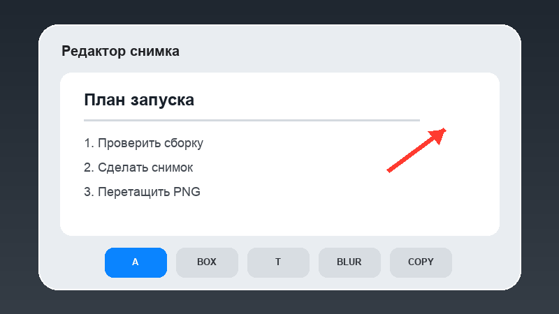

# Скриншутер

**Выделите область, добавьте подпись или размойте личное и перетащите готовый PNG прямо в чат.**

Скриншутер открывает редактор сразу после захвата и хранит недавние снимки на полке. Снимки и распознавание текста остаются на Mac.

**[Скачать DMG](https://github.com/bogdan0dzuba/screenshotapp-bogdan/releases/latest/download/ScreenshotApp-Bogdan-macOS-Universal.dmg)** · [ZIP](https://github.com/bogdan0dzuba/screenshotapp-bogdan/releases/latest/download/ScreenshotApp-Bogdan-macOS-Universal.zip)

Требуется **Apple Silicon и macOS 14 или новее**.

## Что умеет

- Снимать область по своему хоткею, а окно или весь экран — из меню.
- Склеивать длинные страницы в один PNG.
- Копировать текст со снимка на русском и английском.

[Демо полки](docs/assets/shelf-demo.gif) · [Хоткей](docs/assets/hotkey-demo.gif) · [Прокрутка](docs/assets/scroll-capture-demo.gif)

## Установка и первый снимок

1. Откройте DMG, перетащите Скриншутер в «Программы» и запустите.
2. Нажмите `⌘⇧A`. Если разрешение «Запись экрана» еще не выдано, выберите экран в системном диалоге.
3. Выделите область. Снимок откроется в редакторе.

Если macOS не подтверждает разработчика при первом запуске, воспользуйтесь [инструкцией Apple](https://support.apple.com/en-us/102445).

Обновления доступны в меню Скриншутера по команде «Проверить обновления…».

[Приватность](PRIVACY.md) · [Сборка из исходников](script/build_and_run.sh)
